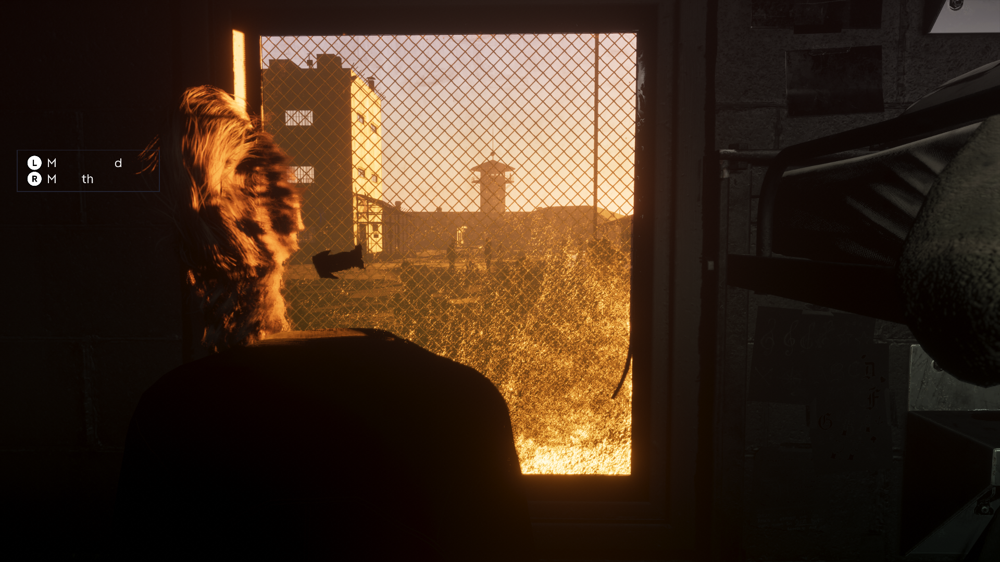
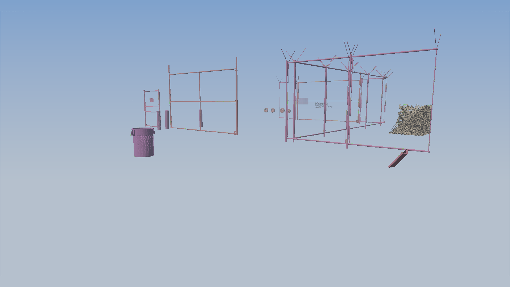
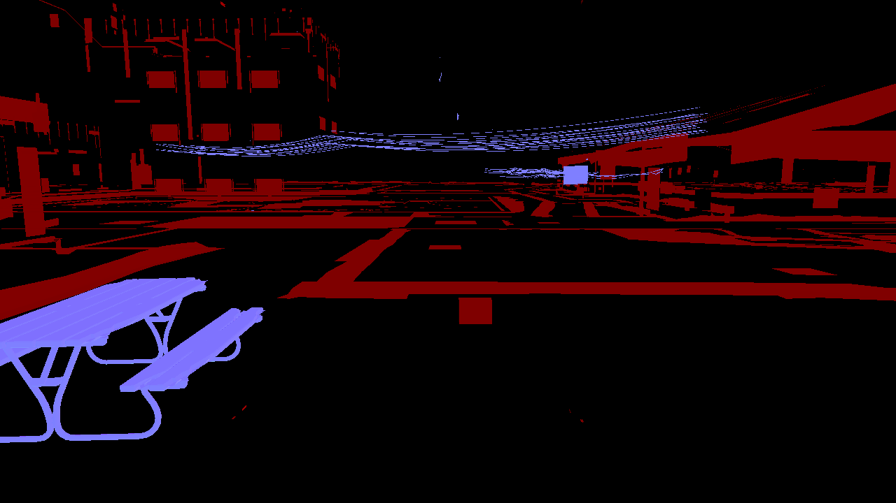
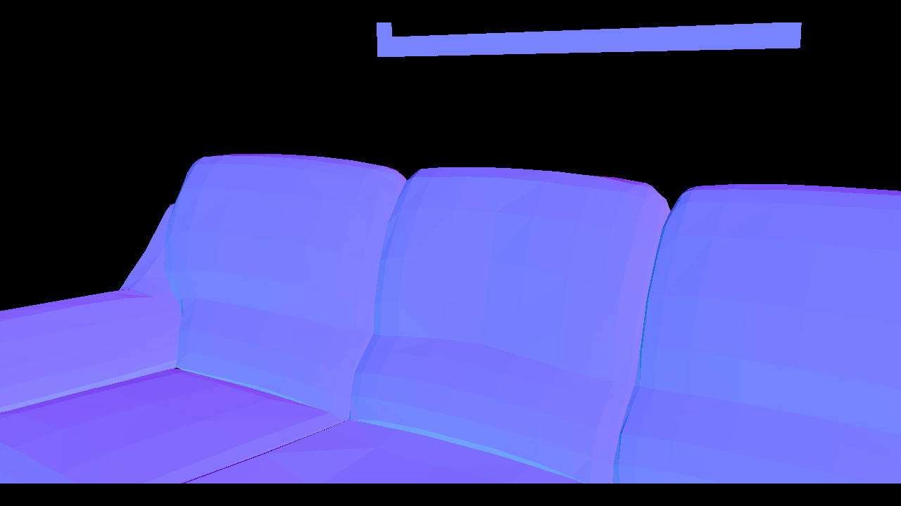
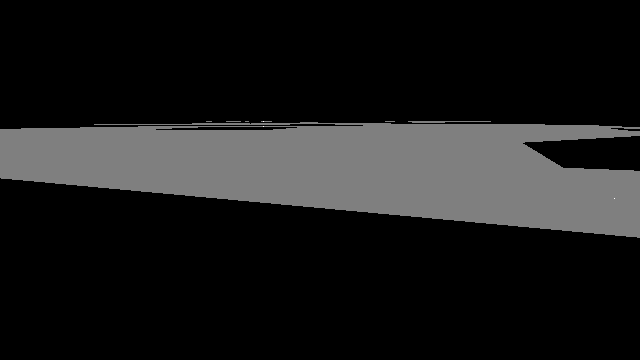
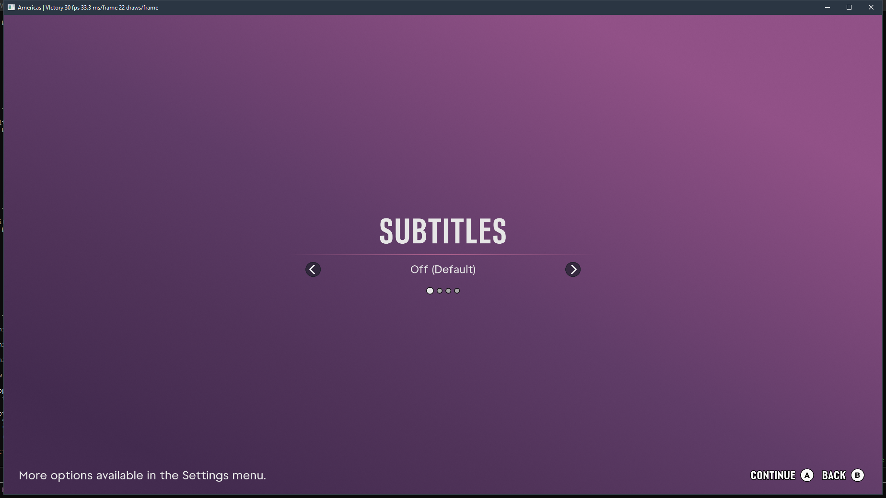

<div align="center">

# ScarlettPort

**A bring-your-own-copy compatibility layer for Xbox Series X|S titles on Windows.**
No emulator, no streaming. The title's own x64 code runs on your CPU, and its RDNA2 GPU code is recompiled for your graphics card on the fly. You supply a dump of your own legally purchased copy; nothing of any title is included here. Wine and Proton are the spirit of it.

### Where it stands

Developed and tested so far against one open-world title. It boots, gets through the menus, saves and legal screens, reaches the world and starts gameplay: about 5 fps in the cell scene and about 4 fps while moving on an RTX 3060 (Series S profile), with stable frame pacing. The yard stutter is fixed; the lighting is wrong (ray tracing is off) and first runs freeze on pipeline compiles while moving, so it is **not yet verified playable**.


```
█████████████░░░░░░░  65%
```

`boots` ✅ → `intro & menus` ✅ → `world loads` ✅ → `lit world` ✅ → `gameplay starts` ✅ (~4-5 fps) → `shadowed areas` 🔨 → `playable speed` ⏳

<a href="https://www.paypal.me/SalwanStudios"></a>
<a href="https://ko-fi.com/ziggymar"></a>

<sub>Donations are voluntary gifts that support development time. They are not a purchase: they buy no game content, access, builds or perks.<br>PayPal: please send as <b>Friends & Family</b> (a gift).</sub>

</div>

---

## 📸 Screenshots

All captured on an RTX 3060 under Windows 10.

### Gameplay view, lit



<sub>The title's own final image in gameplay: sunlight, textures, a fence and buildings, with the movement hint on screen. Shadowed areas are still too dark and some HUD text is cut off. Built on the public VIctory fork by fxceless (GPL-3.0) with community work and our changes on top.</sub>

### Gameplay view with stand-in lighting (earlier build)



<sub>An earlier build, before the title's own lighting translated: a stand-in lighting pass (sky, a sun, fog) over the world's own geometry buffers. Fences, a bin and props are drawn; terrain and most surface colours are missing.</sub>

### First gameplay frame (earlier build)


<sub>The title's own movement hint, drawn over a still-black 3D picture because the lighting shaders did not all translate yet in that build.</sub>

### Street, debug colours (earlier build)



<sub>One of the title's own geometry buffers shown in the window with a debug colour view, in real time. Lighting and textures are not there. That view is not part of the current runtime source.</sub>

### Interior, debug colours (earlier build)



<sub>A sofa from an interior scene, drawn in real time with the same debug colour view of an internal buffer. The geometry is there; the lighting pass still output black in that build.</sub>

### First world geometry (earlier build)



<sub>One of the title's own render passes drawing the ground in 3D perspective. An internal pass, not a final image.</sub>

### First-boot settings screen



<sub>A first-boot settings screen drawn by the title on the VIctory runtime; the window caption shows 30 fps. Other screens (title artwork, loading screens, legal notices) are left out of this repo on purpose.</sub>

---

## 🧱 What blocks a good picture

Measured on an RTX 3060 (Series S profile, the title's own upscaler):

- **Speed:** about 4 fps while walking and turning in the world, with steady pacing (95th-percentile frame about 270 ms). That is far from 30 fps. The GPU profiler (`VICTORY_GPU_PROFILE`) measures about 93-111 ms of GPU time per frame, spread over about 1,100 pipelines, so no single pass is the one to fix. The intro cutscene is very slow unless it is skipped.
- **Pipeline compile freezes:** on a first run, moving into new areas freezes while pipelines compile. The shader prewarm and the pipeline cache shorten this on later runs.
- **Hair renders too bright; shadowed areas are too dark.** The screen lighting passes are fixed (their workers are on by default), but the title's ray-traced lighting and shadows do not run yet (ray tracing is off); the ray-tracing work so far is described in [`runtime/victory/docs/fork-ray-tracing.md`](runtime/victory/docs/fork-ray-tracing.md).
- **Not verified playable:** nobody has played a session end to end.

Details: [`docs/STATUS.md`](docs/STATUS.md). Plan: [`docs/ROADMAP.md`](docs/ROADMAP.md).
Questions: [`docs/FAQ.md`](docs/FAQ.md). Problems: [`docs/TROUBLESHOOTING.md`](docs/TROUBLESHOOTING.md).

---

## 🆕 New in v0.4.2

Measured on an RTX 3060 (Series S profile): about 4 fps while walking and turning in the world, with steady pacing (95th-percentile frame about 270 ms).

- **Lighting passes fixed:** the screen passes have workers of their own, on by default (`VICTORY_SCREEN_WORKERS=0` turns them off).
- **Texture reserve fix:** the room kept for card copies is capped (`VICTORY_CARD_ROOM_KEPT_MB`, 512 by default), so the reserve no longer takes the memory textures need.
- **Load time:** running from an internal SSD, the world is reached in about 212 s, against 300 s or more before.
- **In-session A/B tooling:** switches are compared live within one game session.
- **GPU profiler** (`VICTORY_GPU_PROFILE`): GPU time is about 93-111 ms per frame, spread over about 1,100 pipelines.
- **Shader optimizer:** the safe mask removes 51% of instructions offline; the in-game test is pending, so it stays off.
- **Launcher 0.4.2:** the Stable preset adds `VICTORY_FRIENDLY=1`, which leaves processor time to the desktop while the title runs.
- **Known issues:** hair renders too bright, ray tracing is off, and the speed is far from 30 fps.

## New in v0.4.0

Measured on an RTX 3060 (Series S profile): about 5 fps in the cell scene, about 4 fps while moving, stable frame pacing.

- **Yard stutter fixed:** lazy remapping of title memory plus the copy fix (`VICTORY_REMAP_LAZY`, `VICTORY_MEM_SUBPAGE`, `VICTORY_COPY_NOQUERY`).
- **Copies cut** from 286 to 84 MB per frame.
- **Fast boot fixed** (`VICTORY_FAST_BOOT`); it stays optional and off in the presets.
- **In-session A/B tooling:** switch variants cycled live within one game session (`VICTORY_AB`), with a per-variant summary.
- **Shader prewarm:** shaders are translated ahead of play, so fewer compiles land mid-session.
- **Launcher 0.4.0:** the Stable preset uses the fx-cand4 settings above.
- **Known issues:** the lighting and hair look wrong (ray tracing is off); pipeline compiles freeze the picture when moving on a first run.

## 🧪 Still in progress

"In testing" means built and unit-tested, waiting for A/B game runs on our RTX 3060; "planned" means not built yet. None of these items has a measured fps gain yet.

| Work | Status | What it does |
|---|:---:|---|
| Missing geometry: character skin shaders | 🧪 in testing | skin, hair and clothes pixel shaders that were refused (draws dropped) translate again |
| Missing geometry: mesh output limit | 🧪 in testing | the 71 over-budget mesh shaders are linked under D3D12's 32 KiB output limit instead of being dropped on NVIDIA |
| Missing geometry: view heap | 🧪 in testing | view heap sized so world draws no longer run out of slots on NVIDIA |
| CPU recording cuts | 🧪 in testing | less per-draw preparing and recording cost on the CPU, with a per-part timing line to measure it |
| Zero-copy title memory | 🔨 in progress | `VICTORY_ZERO_COPY`: the GPU reads title memory without copies; needs placing to work at scale |
| Shader optimizer | 🧪 in testing | the safe mask of `VICTORY_SHADER_OPT` removes 51% of instructions offline; the in-game test is pending |
| Hair too bright | 🔨 in progress | the screen lighting passes are fixed (workers on by default); hair now renders too bright, and the hit-shading passes need `VICTORY_RT_RESOLVE` |
| Ray-tracing BVH builder | 🔨 in progress | `VICTORY_BVH_BUILDER` still makes stray writes |
| Load time | 🔨 in progress | the world is reached in about 212 s from an internal SSD (300 s or more before); a load cache (`VICTORY_LOAD_CACHE`) and a faster decoder (`VICTORY_FAST_INFLATE`) are in the runtime, off by default, not measured yet |
| World-entry copy stall | 📋 planned | cut the copies that stall entering the world |
| PC responsiveness | 🧪 in testing | `VICTORY_FRIENDLY=1` (set by the Stable preset): background work leaves processor time to the desktop |
| Textures never uploaded | 📋 planned | 14,830 textures are never uploaded |
| FSR upscaler | 📋 planned | the title's FidelityFX calls answered by AMD's PC FidelityFX |
| Frame generation | 📋 planned | only once the base frame rate is high enough for it to make sense |
| Save safety | 🧪 in testing | protects your save folder from being overwritten by test runs |
| One-command benchmark queue | 🧪 in testing | queues A/B runs of switch sets and collects the frame-time logs in one command |
| Launcher: Controller line | 🧪 in testing | the Play page shows a connected Xbox pad or PlayStation pad (DualShock 4, DualSense, Edge); PlayStation pads are read natively over USB (`VICTORY_PAD_PS`) |
| Launcher: Prepare shaders | 🧪 in testing | after the shader translation, `victory precompile-graphics` makes the graphics pipelines at low priority, with progress and Stop/resume, so moving in the world does not stutter on first use |
| Launcher: drive note | 🧪 in testing | Settings says to keep the game folder on an internal NVMe/SSD for load times |

---

## 🚦 Where we are

| Stage | Status | Notes |
|---|:---:|---|
| Executable loads, imports bind | ✅ | the title's console DLLs load |
| Intro, setup and menus | ✅ | 30 fps, audio plays |
| Saves and legal screens | ✅ | the title saves a checkpoint and loads it again |
| Open world loads | ✅ | world data streams in through DirectStorage |
| Lit world renders | ✅ | about 5 fps in the cell scene, about 4 fps moving, on an RTX 3060 (Series S profile); lighting and hair wrong while ray tracing is off |
| Gameplay starts | ✅ | the prologue runs; not played end to end |
| Pipelines prebuilt | ✅ | 25,200 of 25,471 graphics pipelines made ahead of time, and used in play |
| Shaders translate (VIctory-based translator) | ✅ | all 26,084 translate; 26,013 pass DXIL validation on their own, the other 71 (oversized mesh shaders) validate only when linked with their pixel shader. XCL's counts differ ([`docs/STATUS.md`](docs/STATUS.md)) |
| Keyboard and mouse | ✅ | click to capture, W walks the character |
| Tile-grid overlay over gameplay | ✅ | fixed (rectangle-list pipelines decode right) |
| Shadowed areas | 🔨 | too dark |
| Intro cutscene | 🔨 | very slow unless skipped |
| Speed work | 🔨 | stable frame pacing, yard stutter fixed, copies cut from 286 to 84 MB per frame; pipeline compile freezes on first runs |
| Playable | ⏳ | not verified |
| 30 fps on a mid-range PC | ⏳ | the goal |

---

## 🚀 Run it

> **You need your own dump of your own legally obtained Xbox Series copy.** This repo contains **no game files** of any kind, and never will.

**Requirements:** Windows 10/11 x64 · a D3D12 GPU with Shader Model 6.6 and mesh shaders (RTX 20-series / RX 6000 or newer) · 32 GB RAM recommended · [Rust](https://rustup.rs) (MSVC) · Windows SDK

**Easiest: the launcher.** Download `ScarlettPort-<version>-win64.zip` from [Releases](https://github.com/ZigZagBoi1/ScarlettPort/releases), extract the whole ZIP (keep `ScarlettPort.exe` and the `runtime` folder side by side), run `ScarlettPort.exe`, pick your dump folder, press **Build shaders**, then **Play**. The release is built by CI from this repo, is not code-signed, and lists SHA-256 checksums in its notes.

The shader build uses the World engine (VIctory-based runtime, `victory warm`) by default:

| | Expected time (12-thread CPU) | What you see |
|---|---|---|
| World engine (default) | about 3 min for `victory warm` (measured 171 s for 25,889 shaders), then about 8 min for the graphics pipelines (491 s for 25,200) | phase, count, the current step and its elapsed time |
| Classic engine (XCL, Settings → Game) | 20–30 min with "skip slow shaders" on; 45 min to several hours with it off | the same, plus "no output for N s" during the slow tail |

- **It resumes.** Stop it or close the launcher at any time; pressing **Build shaders** again skips what is done (finished phases are recorded in `<cache>\build-world.json`, translated shaders are read back from the cache).
- **What "83%" means (Classic engine).** XCL's precompile gets through about 22,400 of 26,503 programs quickly. The last ~4,000 are huge world compute shaders that the graphics driver takes 6–190 s each to compile, and the counter only moves when one finishes, so it can sit at 83–85% for a long time while still working. The launcher now shows the time since the last progress and runs as many of these at once as your CPU and free RAM allow. With **Skip slow shaders** (Settings → Options, on by default, 60 s) a step that shows no progress for that long is stopped and the rest compile on demand in game. Or switch to the World engine, which does not have this tail.

To run the runtimes without the launcher, two are included ([`docs/RUNTIMES.md`](docs/RUNTIMES.md)):

**A. VIctory-based runtime: furthest today** (lit world)

```powershell
git clone https://github.com/ZigZagBoi1/ScarlettPort.git
cd ScarlettPort
.\scripts\setup-victory.ps1                                   # build + Agility SDK
.\scripts\play-victory.ps1 -Game "D:\path\to\your\dump"       # Series S profile by default
```

**B. XCL: menus and loading screens**

```powershell
.\scripts\setup.ps1 -Game "D:\path\to\your\dump"     # build + Agility SDK + precompile shaders (45 min to hours, once; resumes)
.\scripts\play.ps1  -Game "D:\path\to\your\dump" -AutoMenu
```

- `play-victory.ps1` sets the recommended environment (`--console series-s`, `VICTORY_OWN_UPSCALER=1`, `VICTORY_NO_WATCHDOG=1`). Its switches include `-AutoInput`, `-FastBoot` (testing only) and `-SaveSlot`.
- While the game runs, write button names into `press.txt` (e.g. `DOWN DOWN A`) to press them.
- Logs go to `logs\`. Attach one when you open an issue.
- Controls: an Xbox controller works best. On the VIctory runtime with no pad connected, the keyboard is a pad: Enter = A, Backspace = B, WASD = left stick, IJKL = right stick.

Environment variables: [`docs/RUNTIMES.md`](docs/RUNTIMES.md). Build instructions: [`docs/BUILDING.md`](docs/BUILDING.md).

---

## ❓ FAQ

**The shader build looks stuck at ~85%.**
That is the Classic (XCL) engine's slow tail: the last ~4,000 of 26,503 programs are huge world shaders that the graphics driver compiles in 6–190 s each, so the count stops moving for minutes at a time while it is still working (one report: 22,200/26,503). Update the launcher: it uses the World engine by default (about 3 minutes), shows the current step and how long it has taken, and with **Skip slow shaders** on leaves the slowest ones to compile in game. Whatever you already built is kept; pressing **Build shaders** again resumes.

**Do I need to rebuild after updates?**
After a launcher or runtime update the launcher marks the shaders as needing a rebuild. The shipped World engine keys its shader cache on the whole translator source, so a runtime update that changes the shader translator translates everything again (about 3 minutes); an update that does not touch the translator reuses the cache and the rebuild finishes quickly. A per-shader key that rebuilds only changed shaders exists in our fork (`fx-cachekey`) but is not in the runtime shipped here yet. The Classic engine's cache is keyed by the generated code, so it recompiles what changed.

**Does the launcher go online?**
Only for what you see: with "Updates" on (Settings → Options) it asks GitHub Releases at start whether a newer launcher exists. An update downloads only when you click it, into an `update` folder beside the launcher, is checked against the release's SHA-256 list, and is swapped in the next time you start the launcher; the replaced version is kept in `previous` for a rollback. "Send report" opens a prefilled GitHub hardware-report issue in your browser (your user name and folders are removed from the log). Discord status talks only to the Discord app on your PC.

**Will auto-update trigger antivirus?**
It can. Unsigned apps that download and replace executables can get reputation warnings (SmartScreen or antivirus) until a release has built up reputation. Our updater only acts when you click it, checks every file against the release's SHA-256 list, keeps the replaced version in `previous` for a rollback, and never uses `%TEMP%`. It updates only the launcher and its bundled `runtime` folder; a local build you picked in Settings → Runtime is never touched. If your antivirus flags a release, please report it as a false positive: [Microsoft's submission page](https://www.microsoft.com/en-us/wdsi/filesubmission).

**Can I run my own runtime build?**
Yes: Settings → Runtime → Local build, then browse to its `victory.exe` (keep its `D3D12` folder beside it) and pick a cache folder. The Stable preset sets the verified C1 environment, so no play script is needed.

**How can I contribute?**
Read [`CONTRIBUTING.md`](CONTRIBUTING.md), then pick a task below or open an issue with one of the [issue templates](https://github.com/ZigZagBoi1/ScarlettPort/issues/new/choose) (bug report, hardware report, shader failure). Testers with different GPUs and hardware reports help most right now: GPU, driver, CPU, RAM, how long the shader build took and how far the game got.

---

## 🤖 Task board: grab one, send a PR

Every task is sized for **one person + one AI coding agent**. Pick one, comment on its issue to claim it, and send a PR. Read [`CONTRIBUTING.md`](CONTRIBUTING.md) first (it takes two minutes).

### Rendering

- [ ] **#1 Light in shadow.** Ray-traced bounce light and shadows do not run yet, so shadowed areas are too dark. See `runtime/victory/docs/fork-ray-tracing.md`.
- [ ] **#2 Missing walls and roofs.** Some cards lose the first room's walls and roof with certain switches; find the cause (see `runtime/victory/VICKY.md`).
- [ ] **#3 Faster wave64 on NVIDIA.** 64-lane programs run as two 32-lane halves. Profile them and cut the overhead.
- [ ] **#9 `VICTORY_SHADER_OPT` in game.** The safe mask removes 51% of instructions offline; its in-game test is pending. One of the other clean-up passes loses walls in game, and an offline differential found nothing. Run the safe mask in game, then find which pass loses walls and why. `runtime/victory/crates/victory-shader/src/emit/mod.rs` (`shader_opt`), `emit/bitcode.rs`.
- [ ] **#10 Hair renders too bright.** The screen lighting passes are fixed (`VICTORY_SCREEN_WORKERS`, on by default). Hair is now too bright; it needs the hit-shading passes, which only run with `VICTORY_RT_RESOLVE`. `runtime/victory/crates/victory-gpu/src/pipeline/make.rs`.
- [ ] **#11 Ray-tracing BVH builder.** `VICTORY_BVH_BUILDER` makes stray writes; find and fix them (upstream VIctory #2402 and #916 are related). `runtime/victory/crates/victory-gpu/src/pipeline.rs`, `runtime/victory/crates/victory-shader/src/bvh.rs`.
- [ ] **#12 Textures never uploaded.** 14,830 textures are never uploaded; find out why they are skipped. `runtime/victory/crates/victory-gpu/src/texture.rs`, `descriptor/host.rs`.

### Performance

- [ ] **#4 Frame time.** About 4 fps while walking and turning in the world (95th-percentile frame about 270 ms). `VICTORY_GPU_PROFILE` measures about 93-111 ms of GPU time per frame, spread over about 1,100 pipelines. See `runtime/victory/crates/victory-gpu/src/host.rs`, `draw.rs`.
- [ ] **#5 Intro cutscene speed.** The intro is very slow unless skipped; find out why.
- [ ] **#13 Zero-copy title memory.** `VICTORY_ZERO_COPY` maps title memory for the GPU without copies; it needs placing to work at scale. `runtime/victory/crates/victory-gpu/src/zerocopy.rs`, `runtime/victory/crates/victory-hle/src/modules/xmem.rs`.
- [ ] **#14 Load time.** The world is reached in about 212 s from an internal SSD. A load cache (`VICTORY_LOAD_CACHE`) and a faster decoder (`VICTORY_FAST_INFLATE`) are in the runtime, off by default: measure them. `runtime/victory/crates/victory-hle/src/modules/dstorage/loadcache.rs`.
- [ ] **#15 World-entry copy stall.** Entering the world stalls on memory copies; find what is copied and cut it. `runtime/victory/crates/victory-gpu/src/memcopy.rs`, `host.rs`.
- [x] **#16 PC responsiveness while running.** Done: `VICTORY_FRIENDLY=1` keeps the rest of the PC usable (thread priorities, worker counts); the Stable preset sets it. `runtime/victory/crates/victory-core/src/friendly.rs`.
- [x] **#6 Shader cache warm-up.** Done: `victory precompile-graphics` and the shader prewarm (`runtime/victory/apps/victory/src/translate.rs`, `runtime/victory/crates/victory-gpu/src/pipeline/precompiled.rs`).

### Tooling & docs

- [ ] **#7 Hardware reports.** Run it on your GPU and post results (GPU, driver, fps, how far it got).
- [x] **#8 One-click launcher** for the VIctory-based runtime (done: it is the launcher's default engine).
- [x] **Launcher 0.4.1.** Done: Controller line on the Play page, the Prepare shaders step, the NVMe/SSD note, and the Stable preset matched to the measured best (native PlayStation pads, no lazy remap).
- [ ] **Controller hot-plug report.** Try the Controller line with wireless (Bluetooth) PlayStation pads and other Xbox-compatible pads, and report what it shows. `launcher/src/controller.rs`.
- [x] **Bring `VICTORY_FRIENDLY` to the vendored runtime.** Done in 0.4.2: the runtime has it and the Stable preset sets it. `launcher/src/presets.rs`.

---

## 🗂️ What's in here

```
ScarlettPort/
├── scripts/          setup.ps1 / play.ps1 (XCL), setup-victory.ps1 / play-victory.ps1 (VIctory-based runtime)
├── runtime/
│   ├── xcl/          XCL (ivall/xcl) with our changes: console OS layer, D3D12.X, RDNA2 -> HLSL -> DXIL
│   └── victory/      VIctory-based runtime: fxceless/victory-fork + merged community work + our changes (see SCARLETTPORT.md)
├── launcher/         native launcher (Rust, egui); runs the engines from a runtime\ folder beside it
├── patches/          our changes to each runtime as plain diffs (xcl-stack.patch, victory-stack-*.patch)
├── docs/             STATUS, RUNTIMES, BUILDING, ROADMAP, FAQ, TROUBLESHOOTING
├── assets/           screenshots
└── LICENSE.md        licensing overview
```

---

## ⚖️ Legal

- This project is **not affiliated with, endorsed by or sponsored by** the developer or publisher of any title it is used with, or by Microsoft. It is free and is not sold.
- It contains **no game files, code, assets or keys**, and no console SDK code.
- It does **not download game files**. The scripts download only Microsoft's public D3D12 Agility SDK from NuGet.
- You need your **own legally obtained copy** of a title and your own dump of it. This project does not provide, link to or help obtain game files.
- Third-party runtimes keep their own licences and credits: `runtime/xcl` is XCL by ivall and contributors (GPL-2.0-only); `runtime/victory` is VIctory by Marvisak and contributors, via fxceless/victory-fork, with community work credited in `runtime/victory/SCARLETTPORT.md` (GPL-3.0-or-later). Each keeps its own `LICENSE`. See [`LICENSE.md`](LICENSE.md).
- Game and company names are trademarks of their owners.

<div align="center">

**If this is useful, star it ⭐ and share it.**

</div>
